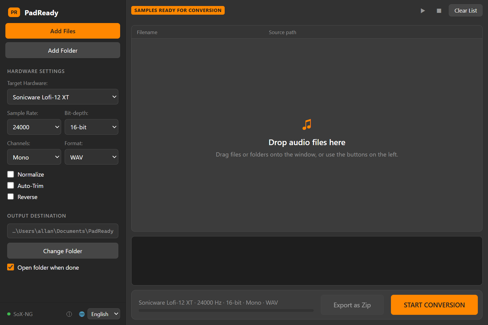

# PadReady v2.2.0

Get any sound in your library ready for your hardware sampler in one drag. PadReady batch-converts audio to the exact format your sampler wants (Sonicware Lofi-12 XT, Elektron Digitakt, Roland SP-404, Polyend Tracker, Teenage Engineering OP-1 and more) and packs the result as a zip kit you can share. Powered by the SoX (Sound eXchange) engine.

PadReady was previously called the Sonicware Lofi-12 XT Tool.

Version 2.0 is a complete rewrite in Electron (Node.js) with a new layout: all hardware settings and the output folder are in the sidebar, and the main window has the file list, a waveform preview and a convert bar with a progress bar. The window can be resized, and the grey and orange colors are the same as before.

The app now runs on [Tauri](https://tauri.app/) instead of Electron: it uses the WebView2 that is built into Windows 10 and 11, so the download is about a tenth of the size and the app starts faster and uses less memory. Everything looks and works the same, and your settings carry over.



## 🚀 Features

- **Batch processing:** Drag and drop multiple files or entire folders (WAV, AIFF, MP3, FLAC, OGG; WMA and M4A need [ffmpeg](#-installation)).
- **Hardware profiles:** One-click presets for:

  | Device | Sample rate | Bit depth | Channels | Format |
  | --- | --- | --- | --- | --- |
  | Sonicware Lofi-12 XT | 24 kHz | 16-bit | Mono | WAV |
  | Sonicware Lofi-12 (Original) | 12 kHz | 16-bit | Mono | WAV |
  | Elektron Digitakt (Mk1) | 48 kHz | 16-bit | Mono | WAV |
  | Elektron Digitakt II | 48 kHz | 16-bit | Stereo | WAV |
  | Roland SP-404MKII | 48 kHz | 16-bit | Stereo | WAV |
  | Roland SP-404SX / SP-404A | 44.1 kHz | 16-bit | Stereo | WAV |
  | Polyend Tracker | 44.1 kHz | 16-bit | Mono | WAV |
  | Teenage Engineering OP-1 / OP-1 field | 44.1 kHz | 16-bit | Mono | AIFF |
  | Teenage Engineering OP-Z | 44.1 kHz | 16-bit | Mono | AIFF |

  You can also pick sample rate (12/24/44.1/48 kHz), bit depth (16/24-bit), channels (mono/stereo) and format (WAV/AIFF) by hand.

  Missing your sampler? [Add it](#-adding-your-device) — it's one line.
- **Smart filenames:** Replaces spaces and invalid characters with underscores and never overwrites existing files (a numbered suffix is added instead).
- **Normalize:** Peak normalization to 0 dB for consistent volume across all your samples.
- **Auto-Trim:** Removes silence at the start and end of each sample.
- **Reverse:** Reverses samples during conversion (output files get a `_rev` suffix).
- **Export as Zip:** Packs the files from the last conversion into one zip file, ready to share as a kit. The zip includes a `README.txt` with the device and settings the kit was made for.
- **Preview:** Click a file to play it and see its waveform (WAV, MP3, FLAC, OGG and M4A; WMA can be converted but not previewed).
- **Blazing fast:** Uses the SoX engine and converts in the background, so the window stays responsive.
- **Clear errors:** Converted files get a ✓ and files that fail are highlighted in the list; hover over one to see the SoX error message.
- **SoX status:** The bottom of the sidebar shows whether SoX or SoX-NG was found; hover over it to see the path.
- **Multilingual:** English, Danish, German, Spanish, French, Italian and Swedish (switch with the language picker at the bottom of the sidebar).
- **Open source:** Free to use, modify, and distribute.

Output is WAV or AIFF.

## 🛠 Installation

1. **Download the tool:** Get the latest release from the [Releases](https://github.com/tristan202/PadReady/releases) page:
   - `PadReady_x.y.z_x64-setup.exe` is a normal step-by-step installer: choose whether to install just for you (no admin rights needed) or for all users, and pick the install folder. It adds a Start menu and desktop shortcut, and can be removed again from Windows Settings > Apps. If WebView2 is missing (only on old Windows versions), the installer downloads it.
   - `PadReady-x.y.z-portable.zip` runs without installing: unzip it anywhere and start `PadReady.exe` (keep the `sox` folder next to it).

   If you have PadReady 2.x installed, uninstall it from Windows Settings > Apps first; your settings are kept.
2. **SoX is included:** PadReady comes with [SoX-NG](https://codeberg.org/sox_ng/sox_ng) 14.7.2, the audio engine that does the conversion, so there is nothing else to install. It reads WAV, AIFF, MP3, FLAC and OGG.

   To use your own SoX instead (for example a build that also reads WMA and M4A through ffmpeg), place `sox.exe` or `sox_ng.exe` and its `.dll` files in the folder you installed PadReady to. The tool looks for SoX in this order:
   - the same folder as the tool (for the installed version that is the folder you picked, by default `%LOCALAPPDATA%\PadReady` for just you or `C:\Program Files\PadReady` for all users),
   - `C:\Program Files (x86)\sox-14-4-2\`,
   - any folder on your `PATH`,
   - the SoX-NG that comes with PadReady.
3. **Run:** Open the tool and you are ready to go.

Settings are stored in `%APPDATA%\PadReady\settings.json`. Converted files go to `Documents\PadReady` by default.

## 📖 How to Use

1. **Add files:** Drag and drop audio files or folders into the list, or use the **Add Files** / **Add Folder** buttons. Adding a folder doesn't include its subfolders.
2. **Set output:** Choose where you want your converted samples to be saved with **Change Folder**.
3. **Adjust settings:** Pick a target hardware profile, or select sample rate, bit depth and channels yourself. Enable **Normalize**, **Auto-Trim** or **Reverse** as needed.
4. **Convert:** Hit **START CONVERSION**. Progress is shown below the settings, along with the number of failed files, if any. Enable **Open folder when done** to have the output folder open automatically.
5. **Share (optional):** Click **Export as Zip** to save the converted files as one zip file you can share with other owners of the same sampler.

## 🧑‍💻 Building from Source

You need [Node.js](https://nodejs.org/) 20 or newer and [Rust](https://rustup.rs/) (see the [Tauri prerequisites](https://tauri.app/start/prerequisites/)).

```bash
npm install
```

Run the app (it finds `sox.exe` / `sox_ng.exe` in the project folder, on your `PATH`, or in `vendor/sox` after `npm run fetch-sox`):

```bash
npm start
```

Run the tests (JavaScript with Node, then the Rust side with `cargo test`; the conversion tests are skipped if SoX isn't found):

```bash
npm test
```

Build the Windows installer. This first runs `npm run fetch-sox`, which downloads the official SoX-NG Windows build and its source code from Codeberg into `vendor/` and checks their SHA-256 checksums, so SoX is bundled with the app:

```bash
npm run dist
```

Build the installer and the portable zip:

```bash
npm run dist:portable
```

The installer ends up in `src-tauri/target/release/bundle/nsis/`, the portable zip in `dist/`.

The app uses Tauri, so it can in principle run on macOS and Linux with `sox` installed from your package manager, but only Windows has been tested.

The original PureBasic version (v1.x) is still available in the git history and in the v1.0.0 release.

## 🎛 Adding Your Device

Device presets live in [`src/renderer/devices.json`](src/renderer/devices.json). To add a sampler, add one line and open a pull request:

```json
{ "name": "Maker Model", "sampleRate": 44100, "bitDepth": 16, "channels": 1 }
```

- `sampleRate`: 12000, 24000, 44100 or 48000
- `bitDepth`: 16 or 24
- `channels`: 1 (mono) or 2 (stereo)
- `format` (optional): `"wav"` (default) or `"aiff"`

Please link the device's manual or spec page in the pull request so the values can be checked. `npm test` checks that every entry uses supported values. If your device needs a sample rate that isn't listed, add it to `SAMPLE_RATES` in `src/renderer/renderer.js` and to the test as well. Please also add a row to the table under Features.

If you can't make a pull request, [open an issue](https://github.com/tristan202/PadReady/issues) with the device name and its sample format.

## 📜 License

This project is licensed under the [GNU General Public License v3.0](LICENSE).

You are free to use, study, modify and distribute this software, including commercially. If you distribute it or a modified version, you must make the source code available under the same license.

### Third-party software

The installer and portable zip include [SoX-NG](https://codeberg.org/sox_ng/sox_ng) 14.7.2 (`sox_ng.exe`), unchanged from the official Windows build. SoX-NG is licensed under the [GNU General Public License v2](https://codeberg.org/sox_ng/sox_ng/src/branch/main/COPYING); the license text is installed next to it as `sox\COPYING`. Its source code is attached to every PadReady release as `sox_ng-14.7.2.tar.gz` and is also available from the [SoX-NG 14.7.2 release](https://codeberg.org/sox_ng/sox_ng/releases/tag/sox_ng-14.7.2). The Windows build is statically linked with libraries such as libmad, libsndfile, FLAC, libvorbis and Opus; see the SoX-NG [MXE build instructions](https://codeberg.org/sox_ng/sox_ng/wiki/Distro-MXE.md) for how it is built.

## 👤 Credits

Created by [tristan202](https://github.com/tristan202).

Special thanks to the Sonicware community for inspiration.
